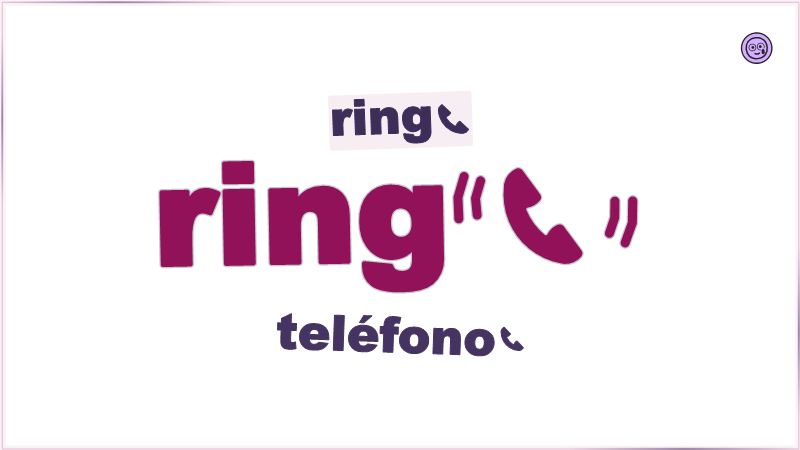

# Neon Lyrics

Convierte tu escritorio de Windows en un fondo animado con la letra de lo que escuchas en Spotify. Las palabras aparecen detrás de los iconos del escritorio y siguen la reproducción al pausar, adelantar o retroceder.

**[Descargar Neon Lyrics para Windows](https://github.com/matoeramores-ship-it/neon-lyrics/releases/latest/download/Neon-Lyrics.exe)** · [Ver las versiones](https://github.com/matoeramores-ship-it/neon-lyrics/releases)



## Usar el fondo

1. Guarda `Neon-Lyrics.exe` en una carpeta de tu PC y ábrelo.
2. Reproduce una canción en la aplicación de Spotify para Windows.
3. Haz clic derecho en el icono de Neon Lyrics junto al reloj y elige un fondo. Si el icono está oculto, abre la flecha de la bandeja. Desde el mismo menú puedes mostrar u ocultar el fondo y activar **Iniciar con Windows**.

Puedes elegir fondo negro, blanco, barco, ojo de pez con o sin portada, o videoclip. Los objetos reaccionan a la letra, las vocales sostenidas se alargan y los tramos instrumentales reconocidos muestran una onda que responde al volumen. Los emojis de la esquina se pueden desactivar.

## Letras y servicios

Neon Lyrics lee el título, el artista y la posición de reproducción desde la sesión multimedia de Windows. Busca la letra sincronizada en LRCLIB. La disponibilidad depende de la canción y, cuando la letra solo tiene tiempos por línea, la posición de cada palabra es aproximada. Los emojis se eligen en el equipo.

El fondo con portada puede consultar Deezer por artista y álbum para mejorar la imagen. El modo de videoclip pide permiso para buscar por título y artista en Internet Archive. Reproduce el vídeo en silencio y muestra la portada cuando no encuentra una coincidencia.

## Compilar y probar

En Windows de 64 bits, abre PowerShell en la raíz del repositorio. El script utiliza el compilador de .NET Framework de Windows y los metadatos de Windows Runtime instalados en el sistema.

```powershell
powershell.exe -NoProfile -ExecutionPolicy Bypass -File .\Build.ps1
.\Check.exe
```

La compilación genera `Neon Lyrics.exe` y `Check.exe`. La prueba predeterminada usa datos de ejemplo y verifica la sincronización y el dibujo de los fondos.

La aplicación incorpora YamlDotNet 16.3.0 y NAudio 1.10.0. El repositorio incluye ambas bibliotecas y sus avisos de licencia. [YamlDotNet](YamlLicense.txt) · [NAudio](NAudioLicense.txt)
